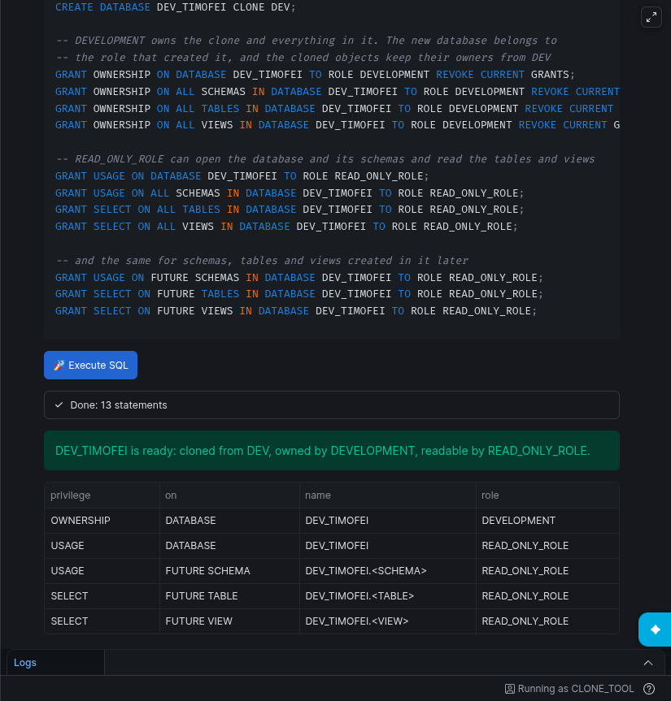
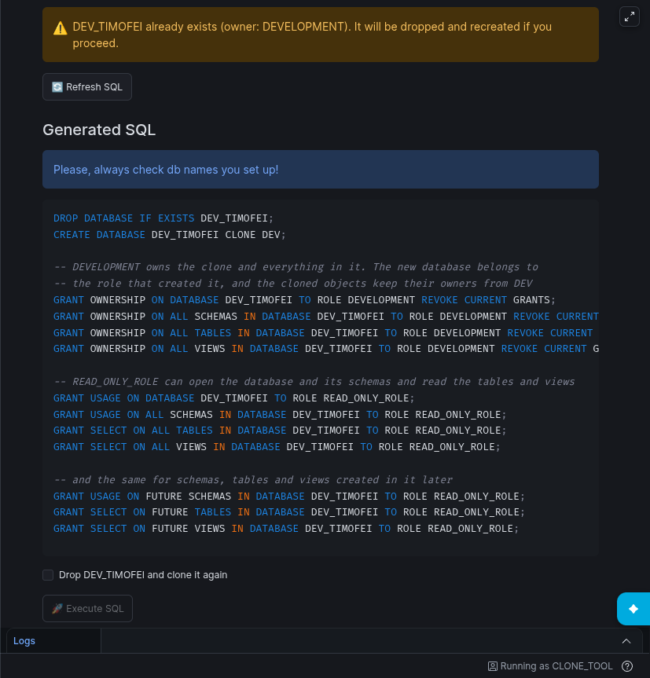
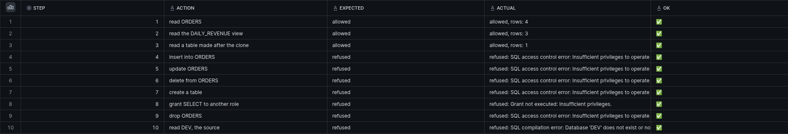

# DB clone tool

A Streamlit app in Snowflake that clones a database for development. The
owner role gets the clone and everything in it, the read-only role can only
read it.

- `setup.sql`: the roles, what the app's role may do, and a small `DEV`
  database to clone
- `streamlit_app.py`: the app
- `check.sql`: checks a clone made by the app

## Setup

1. Run `setup.sql` as ACCOUNTADMIN with **Run all**. Running it again is safe.
2. In a workspace, **+ Add new » Streamlit app**. Replace the code in its
   `streamlit_app.py` with this one and leave the other files as they are.
3. In **Settings » Targets**, set the deploy target:
   - owner role `CLONE_TOOL`: untick "Deployed app owner role matches the
     preview execution role" and pick it, or have the preview run as
     `CLONE_TOOL` too and keep the box ticked. If the role isn't listed,
     reload the page: Snowsight reads your roles when it loads
   - App location: `TOOLS.APPS`
   - Compute pool `SYSTEM_COMPUTE_POOL_CPU`, query warehouse `COMPUTE_WH`

   Then **Save settings**.
4. **Deploy**, and open the app.

The line under the app's title shows which role it runs as: it should say
`CLONE_TOOL`.

To let developers use the tool without giving them `CLONE_TOOL`, share the
app with `DEVELOPMENT` (**Share**, View only).

## How it works

- The app runs its queries as its owner role, `CLONE_TOOL`, whoever opens it.
- It shows the SQL only if:
  - the names are plain Snowflake names
  - the target isn't the source or a system database
  - the source and both roles exist
  - an existing target already belongs to the owner role

  So it recreates a developer's own clone, but never some other database.
- Before it drops an existing database, you have to tick a checkbox.
- **Execute** runs the statements one by one and stops at the first error.
  When it finishes, it shows the grants on the new database.

## Why each GRANT

### setup.sql

| Grant | Why |
|---|---|
| `GRANT ROLE DEVELOPMENT / READ_ONLY_ROLE / CLONE_TOOL TO ROLE SYSADMIN` | Custom roles go under SYSADMIN, so admins keep control of what these roles own. |
| `GRANT ROLE ... TO USER` | So I can switch to each role and test. In a team, these go to the people who need them. |
| `GRANT CREATE DATABASE ON ACCOUNT TO ROLE CLONE_TOOL` | A clone is a new database. |
| `GRANT ROLE DEVELOPMENT TO ROLE CLONE_TOOL` | A clone gets only the objects the cloning role can read, and DEV belongs to DEVELOPMENT. Dropping an old clone takes ownership too, and old clones belong to DEVELOPMENT. The app offers only the roles `CLONE_TOOL` inherits as owners, so it can always recreate their clones. |
| `GRANT MANAGE GRANTS ON ACCOUNT TO ROLE CLONE_TOOL` | Future grants on a database need it; owning the database isn't enough. It lets a role grant anything on any object, so it sits on a role only the app runs as. Developers get the app shared with them, not the role. |
| `GRANT USAGE ON WAREHOUSE COMPUTE_WH TO ROLE CLONE_TOOL` | The app's queries run on it, as `CLONE_TOOL`. |
| `GRANT USAGE ON WAREHOUSE COMPUTE_WH TO ROLE DEVELOPMENT / READ_ONLY_ROLE` | To query the clones. |
| `GRANT USAGE ON DATABASE TOOLS`, `USAGE ON SCHEMA TOOLS.APPS`, `CREATE STREAMLIT ON SCHEMA TOOLS.APPS` to `CLONE_TOOL` | To deploy the app there as `CLONE_TOOL`. |
| `GRANT USAGE ON COMPUTE POOL SYSTEM_COMPUTE_POOL_CPU TO ROLE CLONE_TOOL` | Apps made in Workspaces run on a compute pool, and the deployed one runs as `CLONE_TOOL`. |
| `GRANT OWNERSHIP ON DATABASE DEV` and on all its schemas, tables and views `TO ROLE DEVELOPMENT COPY CURRENT GRANTS` | DEV belongs to DEVELOPMENT, like a real dev database. Handing over an object that has grants on it fails unless the statement says what to do with them; COPY keeps them. |

### The app's SQL

| Statement | Why |
|---|---|
| `DROP DATABASE IF EXISTS`, then `CREATE DATABASE ... CLONE` | A fresh copy every time, with the drop as its own statement, so it's in plain sight when you check the names. A clone dropped by mistake comes back with `UNDROP DATABASE` within the Time Travel retention period, once the new one is renamed. |
| `GRANT OWNERSHIP ON DATABASE ... TO ROLE <owner>` | A new database belongs to the role that created it, here `CLONE_TOOL`. The developer should own their clone. |
| `GRANT OWNERSHIP ON ALL SCHEMAS / TABLES / VIEWS ...` | Cloned objects keep their owners from the source. For DEV that's already DEVELOPMENT, but if the source belongs to another role, the developer couldn't change their own clone without this. |
| `... REVOKE CURRENT GRANTS` | Access the objects had in the source (SELECT for some reporting role, say) isn't handed over with them, so only the two roles get into the clone. |
| `GRANT USAGE ON DATABASE ...`, `USAGE ON ALL SCHEMAS ...` to the read-only role | Without USAGE on the database and the schema, nothing inside can be reached. USAGE alone shows no data. |
| `GRANT SELECT ON ALL TABLES / ALL VIEWS ...` | Reading and nothing else: no INSERT, UPDATE, DELETE, CREATE or ownership. |
| `GRANT USAGE ON FUTURE SCHEMAS`, `SELECT ON FUTURE TABLES / FUTURE VIEWS IN DATABASE ...` | What the developer creates later is readable too, without running the tool again. They're set on the database, so new schemas are covered. If a schema has future grants of its own, those win in that schema. |

## Checks

`check.sql` takes a clone made by the app (`DEV_TIMOFEI`). DEVELOPMENT adds a
schema and a table to it, then READ_ONLY_ROLE tries to read and to change
things. Every attempt is caught, and the last result is one table of what
was allowed and what was refused: reads of the clone go through, and the
writes, the grant and reading DEV itself are refused.

Each role is checked with secondary roles off (`USE SECONDARY ROLES NONE`).
Snowsight turns on all of a user's roles as secondary ones by default, and
then a session that uses READ_ONLY_ROLE also has the privileges of the
user's other roles, DEVELOPMENT's ownership of the clone included. Only
CREATE goes by the primary role alone. The app isn't affected by this: it
runs as `CLONE_TOOL` only.

## Results

The app after cloning DEV into `DEV_TIMOFEI`:

The next time, with `DEV_TIMOFEI` already there:

`check.sql` on the clone:

