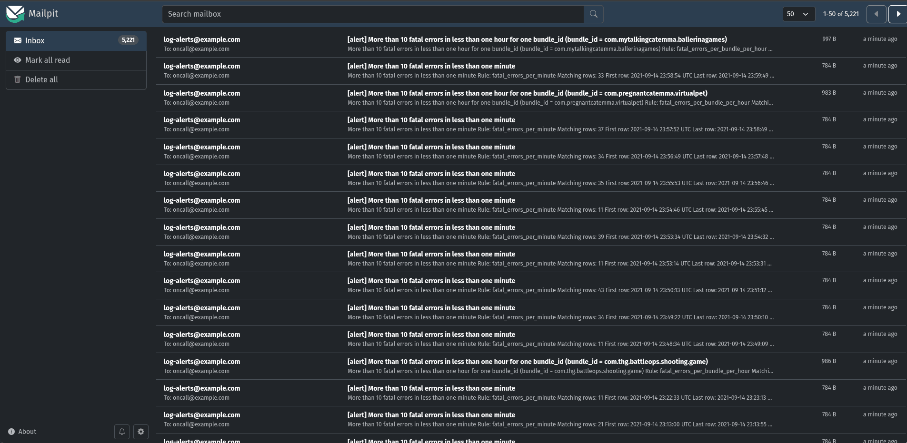
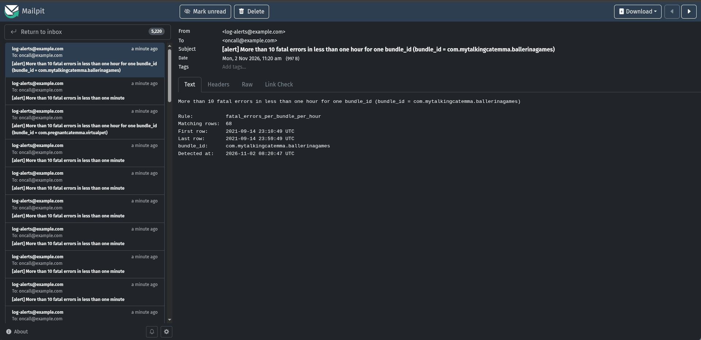

# Log alerts: fatal errors in mobile app logs, found with pandas

A mobile app sends its logs as CSV files, called journals. This project reads
each journal with pandas as it arrives, checks the rows against alert rules
and sends an alert when a rule's threshold is crossed. Both rules from the
task are included:

- more than 10 fatal errors in less than one minute;
- more than 10 fatal errors in less than one hour for one `bundle_id`.

Alerts go to the log, to a JSON Lines file and, by email, to
[Mailpit](https://mailpit.axllent.org/), a mail server for testing that shows
its inbox in the browser. Rules live in `rules.toml`, so a new one is a few
lines of configuration.

```
data/source/data.csv              the dataset
  |
  |  replayer: sorts the rows by `date`, cuts them into one-minute journals
  |            and sends them at SPEED times real time
  v
data/incoming/journal_20210911T000000.csv, ...
  |
  |  processor, journal by journal, in chunks of 100,000 rows:
  |    journal.py     reads all 24 columns, drops malformed rows
  |    rules.py       sliding-window thresholds from rules.toml
  |    notifiers.py   log  |  data/alerts/alerts.jsonl  |  email to Mailpit
  v
data/processed/                   (data/failed/ if a file cannot be read)
```

## The task, item by item

| Requirement | Where |
|---|---|
| Process and analyze the log journals | The processor reads each journal from `data/incoming/` with pandas ([`processor.py`](src/log_alerts/processor.py), [`journal.py`](src/log_alerts/journal.py)) |
| Alert: more than 10 fatal errors in less than one minute | Rule `fatal_errors_per_minute` in [`rules.toml`](rules.toml) |
| Alert: more than 10 fatal errors in less than one hour for one `bundle_id` | Rule `fatal_errors_per_bundle_per_hour` |
| An alert-sending mechanism | Log, `data/alerts/alerts.jsonl` and email ([`notifiers.py`](src/log_alerts/notifiers.py)) |
| Works without errors or bugs | 96 tests, including a comparison with brute-force counting on random data, and a full run on the dataset |
| Clean code and structure, PEP 8 | One job per module in `src/log_alerts/`; ruff for linting and formatting |
| 100 million records a day | About 55,000 rows a second, so a day of 100 million takes about 30 minutes of work ([Performance](#performance)) |
| Starts with one command via docker-compose | `docker compose up --build` |
| A properly kept git repository | `.gitignore` keeps the dataset and everything the services write out of git |
| New alert rules are easy to add | A `[[rules]]` table in `rules.toml`, or a new `Rule` subclass ([Adding rules](#adding-rules)) |
| A README on architecture, running, rules and reasons | This file |

## Running it

You need Docker with Compose v2 (Docker Desktop on macOS and Windows). The
dataset is 500 MB and not in git; put it in `data/source/`:

```bash
cp /path/to/data.csv data/source/data.csv
docker compose up --build
```

Then open http://localhost:8025 for the inbox. On Windows, copy the file with
`Copy-Item C:\path\to\data.csv data\source\data.csv`; the second command is the
same.

On Linux, the containers run as user id 1000, so the files they write into
`data/` belong to you. If `id -u` prints something else, copy `.env.example`
to `.env` and put your ids in it.

What happens next:

1. Mailpit starts, and the processor waits until Mailpit's healthcheck
   passes.
2. The replayer sorts the dataset by time, which takes about 40 seconds, then
   sends the four days of logs in about 96 seconds.
3. The processor logs one `ALERT` line per alert, and every 10 seconds a
   progress line:
   ```
   INFO log_alerts.processor: last 10 s: 610 files, 177,379 rows, 0 rejected, 607 alerts, 8.0 s of work, 22,229 rows/s
   ```
4. The replayer exits when it is done. The processor keeps waiting for new
   journals.

Ctrl+C or `docker compose stop` stops everything; the processor finishes the
journal it is on and logs its totals. Mailpit keeps messages only while it
runs, so look at the inbox before stopping it.

To see the progress lines without the alerts: `docker compose logs processor
| grep -v ALERT` (in PowerShell, `Select-String -NotMatch ALERT` instead of
`grep -v ALERT`).

To start again from scratch:

```bash
docker compose down
rm -rf data/incoming data/processed data/failed data/alerts
```

In PowerShell: `Remove-Item -Recurse -Force data\incoming, data\processed,
data\failed, data\alerts`.

Two settings in `.env` change the replay. `SPEED` is the number of seconds of
log time sent per real second: 3600 by default, 0 for as fast as possible.
`JOURNAL_SECONDS` is the length of a journal in log time, 60 by default. On
bash, zsh and fish they can also go in front of the command:
`SPEED=0 docker compose up --build`.

## What the alerts look like

On the dataset, the processor raises 4,930 per-minute alerts and 291
per-bundle alerts, 5,221 in all, and every one of them reaches the inbox:



A per-bundle alert:



The same alert in the log:

```
WARNING log_alerts.notifiers: ALERT More than 10 fatal errors in less than one hour for one bundle_id (bundle_id = com.mytalkingcatemma.ballerinagames): 68 from 2021-09-14 23:10:49 to 2021-09-14 23:59:49 UTC
```

`data/alerts/alerts.jsonl` gets one JSON object per alert with the rule, the
group (`group_by` and `key`), the count, the first and last row times, and
when the alert was raised.

## The data

The dataset was profiled with pandas before any code was written. Five
findings shaped the design.

**There is no "Fatal" severity.** `severity` is `Error` (1,255,127 rows) or
`Success` (251,025 rows). The only other error code, 203, appears on rows of
both kinds, so it does not mark anything as fatal either. The fatal errors of
the task are therefore the rows with severity `Error`. That is one line per
rule in `rules.toml`, so a real `Fatal` severity would be a one-word change.

**The rows are not in time order.** The file holds four days, 11 to 14
September 2021, shuffled together: consecutive rows jump between days at the
same time of day, row 120 for example from 12 September 10:32 to
11 September 10:54. Only 4,475 of the 1,506,152 rows come after every row
before them in time, and 77% are more than a day older than some earlier
row. Played in file order, almost every row would look days late, so the
replayer sorts by `date` before sending anything.

**`date` is the time to use.** It is a Unix timestamp with microseconds.
`sdk_date` comes from the device and mixes formats (`9/12/2021 10:31:18 AM`
next to `09/12/2021 10:31:16`), so every window uses `date`.

**The first line is not data.** It holds the column numbers `0` to `23`,
which is what pandas writes for unnamed columns. It is dropped like any row
without a usable `date`.

**Some messages span several lines.** Messages such as
`We are running "Programmatic Flow", you need to active gCom.` are followed
by an HTTP response, with line breaks inside the quotes, so the file has
1,540,015 lines but only 1,506,153 records, the first line included. pandas
reads them correctly; cutting the file by lines, with `split -l` for
example, would break those rows, so the replayer works with rows instead.

The dataset has about 376,000 rows a day, from six apps (`bundle_id`), three
of which send almost all of them.

## How it works

### The replayer

`python -m log_alerts replay` plays the mobile app. It sorts the dataset in
two passes so that memory holds one hour of logs, not the whole file:

1. the rows are split into one temporary file per hour of log time;
2. each hour is sorted by `date` and cut into journals of `JOURNAL_SECONDS`.

Sorting the whole file in memory works for this dataset, at about 700 MB on
a test file of the same size, but it grows with the file: a day of 100
million rows would need tens of gigabytes. The two passes hold one hour at a
time and stayed under 200 MB on the same test file.

A journal is named after the start of its stretch of log time, such as
`journal_20210911T000000.csv`, and is sent once that stretch has passed, at
`SPEED` times real time. It is written under a `.part` name and renamed when
complete, so the processor never reads half a journal.

### The processor

`python -m log_alerts process` checks `data/incoming/` every second and
handles the `*.csv` files in name order, which is the order they were
written in. For each journal:

1. [`read_journal`](src/log_alerts/journal.py) reads it in chunks of 100,000
   rows with `pd.read_csv`, so memory stays flat even for a very large file.
   It reads all 24 columns as text and converts `date` to a number. Rows with
   the wrong number of fields, or without a usable `date` or `severity`, are
   dropped and counted as rejected.
2. Every chunk goes through every rule, and the alerts it raises are sent
   before the next chunk is read.
3. The journal moves to `data/processed/`, or to `data/failed/` if it could
   not be read at all. Only reading errors are handled this way; an error in
   a rule is a bug and stops the processor.

Reading all 24 columns, rather than only the three the rules use, has two
reasons. With `usecols`, pandas does not notice a line with an extra field:
it shifts the values into the wrong columns without a warning. Reading every
column lets it skip such a line. And a new rule can then use any column.

### The rules

A rule receives the rows chunk by chunk and returns the alerts. Both task
rules are threshold rules ([`ThresholdRule`](src/log_alerts/rules.py)):

- **Sliding window.** "More than 10 in less than one minute" means any 11
  matching rows within less than 60 seconds, not per clock minute. On the
  sorted times of the matching rows, row `i` completes a burst when
  `t[i] - t[i - 10] < 60`; numpy checks every row in one comparison.
- **Per group.** With `group_by = "bundle_id"`, rows are counted separately
  for each app. Rows without a `bundle_id` are ignored by that rule.
- **One alert per burst.** After an alert the rule stays quiet for that group
  for one window (`cooldown`), so a burst raises one alert, not one per row.
- **Memory between journals.** A rule keeps the times of matching rows from
  the last window plus five minutes. A burst split across two journals is
  still one burst, and memory does not grow with traffic.
- **Log time, not the clock.** Windows use `date`, so replaying old logs
  raises the same alerts, and the size of the journals makes no difference:
  one-minute and one-hour journals both give 4,930 + 291 alerts.
- **Late rows.** A row up to five minutes behind the newest row seen so far
  still counts. A later one is dropped with a warning.

### Sending alerts

Every alert goes through all channels in [`notifiers.py`](src/log_alerts/notifiers.py):

| Channel | What it does |
|---|---|
| Log | One `WARNING` line per alert |
| JSON Lines file | One line per alert in `data/alerts/alerts.jsonl`, the permanent record |
| Email | One message per alert over SMTP, all alerts of a chunk over one connection; only when `SMTP_HOST` is set |

If a channel is down, for example the mail server does not answer, the
error is logged in one line and the other channels still get the alerts.

## Why these tools

- **pandas** is what the task is about, and it fits the job: `read_csv` with
  chunks reads large files in flat memory, and grouping and filtering whole
  columns at once is what makes the throughput below possible. The windows
  themselves are plain numpy on sorted arrays.
- **A folder of CSV files as the input**, because that is how the task says
  the app sends its logs. Writing under a temporary name and renaming makes
  each journal appear at once, complete, without any locking.
- **No Kafka, Spark or Airflow.** 100 million rows a day is about 1,160 rows
  a second on average, and one pandas process handles about 55,000. A message
  broker or a cluster would add parts to run without being needed. If the
  load ever outgrows one process, journals can be split by `bundle_id` across
  several processors, or the folder can be replaced by a Kafka consumer; the
  reader, the rules and the notifiers stay as they are.
- **TOML for the rules**, because Python reads it with the built-in
  `tomllib`, with no extra dependency. `load_rules` checks every rule at
  startup: a typo in an option name, an unknown column or a duration it
  cannot read stops the processor with a message naming the rule.
- **Mailpit** is a real SMTP server with a browser inbox, so whoever runs the
  project sees real emails without creating an account or a bot token. A
  real mail server is a matter of changing `SMTP_HOST` and `SMTP_PORT` (see
  [Limitations](#limitations) for TLS).
- **One Docker image for both services**, `python:3.13-slim` with pinned
  pandas and numpy. The dependencies are their own layer, so a code change
  does not reinstall them; the containers do not run as root; `rules.toml`
  is mounted, so a rule change needs only `docker compose restart processor`.

## Adding rules

### Another threshold rule

Add a `[[rules]]` table to `rules.toml` and restart the processor. For
example, more than 100 fatal errors in less than five minutes from one
country:

```toml
[[rules]]
name = "fatal_errors_per_country"
type = "threshold"
description = "More than 100 fatal errors in less than five minutes from one country"
where = { severity = "Error" }
group_by = "country_code"
window = "5min"
threshold = 100
```

Or failed access tokens, error code 203, with at most one alert an hour:

```toml
[[rules]]
name = "access_token_failures"
type = "threshold"
description = "More than 20 access token failures in less than ten minutes"
where = { severity = "Error", error_code = "203" }
window = "10min"
threshold = 20
cooldown = "1h"
```

| Option | Meaning |
|---|---|
| `where` | Rows that count: `column = "value"`, or `column = ["value", "value"]` for several values |
| `group_by` | Count separately for each value of this column (optional) |
| `window` | A duration such as `"60s"`, `"5min"` or `"1h"`, or a number of seconds |
| `threshold` | Alert when the count goes above this number |
| `cooldown` | After an alert, stay quiet this long for the same group (optional, one window by default) |
| `lateness` | How far behind the newest row a row may arrive and still count (optional, `"5min"` by default) |

### A new kind of rule

A rule that is not a threshold, such as "more than 30% of rows are errors",
is a subclass of [`Rule`](src/log_alerts/rules.py) with two methods,
registered under a type name:

```python
class ErrorShareRule(Rule):
    """More than `share` of the rows in a window are errors."""

    @classmethod
    def from_config(cls, name, description, options):
        # read and check the options from its [[rules]] table
        ...

    def evaluate(self, events):
        # take the next chunk of rows, return a list of Alert
        ...


RULE_TYPES["error_share"] = ErrorShareRule
```

Its tables in `rules.toml` then use `type = "error_share"`.

### A new channel

Slack or Telegram would be a subclass of `Notifier` with a `send(alerts)`
method, added in `build_notifiers` in
[`processor.py`](src/log_alerts/processor.py).

## Performance

Measured on my laptop, on the full dataset of 1,506,152 rows, with every
alert sent by email to Mailpit:

| Run | Journals | Work | Rows per second |
|---|---|---|---|
| Default, `SPEED=3600` | 5,724 of one minute | about 8 s in every 10 s | 20,000–22,000 |
| `SPEED=0`, as fast as possible | 5,724 of one minute | all the time | 18,000–19,000 |
| `SPEED=0 JOURNAL_SECONDS=3600` | 97 of one hour | 27.2 s for all rows | 55,347 |

The replayer's sort took about 39 seconds each time.

Journal size matters because each file has a fixed cost: opening, parsing
setup, moving it. The dataset has only about 260 rows a minute, but at 100
million rows a day a one-minute journal would hold about 70,000. The
hour-long journals here (about 16,000 rows) are the closer comparison: at
55,000 rows a second, a day of 100 million rows takes about 30 minutes of
work, nearly 50 times the average rate. Even the one-minute journals of this
dataset run about 16 times faster than needed.

Memory stays bounded at any volume. The reader holds one chunk of 100,000
rows at a time. The rules keep only the times of matching rows from the last
window plus five minutes: at 100 million rows a day, all of them errors,
the per-bundle rule keeps about 4.5 million numbers, around 36 MB.

## Configuration

Every setting is an environment variable with a default that works from the
project folder. `docker-compose.yaml` sets the ones marked with an asterisk.

Processor:

| Variable | Default | Meaning |
|---|---|---|
| `INCOMING_DIR` | `data/incoming` | Where journals arrive |
| `PROCESSED_DIR` | `data/processed` | Where processed journals go |
| `FAILED_DIR` | `data/failed` | Where unreadable journals go |
| `ALERTS_FILE` | `data/alerts/alerts.jsonl` | The JSON Lines record of alerts |
| `RULES_FILE` | `rules.toml` | The rules |
| `CHUNK_ROWS` | `100000` | Rows read at a time |
| `POLL_SECONDS` | `1` | Wait between checks of an empty folder |
| `REPORT_SECONDS` | `10` | Interval of the progress line |
| `SMTP_HOST`* | (none) | Mail server; email is sent only when set |
| `SMTP_PORT`* | `1025` | Mail server port |
| `ALERT_EMAIL_FROM` | `log-alerts@example.com` | Sender |
| `ALERT_EMAIL_TO`* | `oncall@example.com` | Recipients, comma-separated |
| `LOG_LEVEL` | `INFO` | Log level |

Replayer:

| Variable | Default | Meaning |
|---|---|---|
| `SOURCE_FILE` | `data/source/data.csv` | The dataset |
| `STAGING_DIR` | `data/replay` | Temporary files of the first sorting pass |
| `JOURNAL_SECONDS`* | `60` | Length of a journal in log time |
| `SPEED`* | `3600` | Seconds of log time per real second; 0 for no waiting |

`INCOMING_DIR`, `CHUNK_ROWS` and `LOG_LEVEL` apply to the replayer as well.
An invalid value stops the service with a message such as
`configuration error: CHUNK_ROWS has an invalid value: 'abc'`.

## Tests and code quality

96 tests with pytest, and ruff for linting and formatting. Without Python on
the machine, Docker runs them all from the project folder (in PowerShell,
write `${PWD}` instead of `$PWD`):

```bash
docker run --rm -v "$PWD:/app" -w /app -e PYTHONDONTWRITEBYTECODE=1 python:3.13-slim \
  sh -c "pip install -q -r requirements-dev.txt && pytest -q -p no:cacheprovider && ruff check --no-cache . && ruff format --check --no-cache ."
```

With Python 3.12 or newer:

```bash
python -m venv .venv && source .venv/bin/activate
pip install -r requirements-dev.txt
pytest && ruff check . && ruff format --check .
```

The tests cover:

- **Reading:** quoted commas and line breaks, a line with an extra field,
  every kind of rejected row, chunking, an empty file.
- **Rules:** 11 errors in 59.9 seconds alert and in exactly 60 do not; a
  burst split across chunks; the quiet period; chunk size not changing the
  result; bundles counted separately; late and too-late rows; bounded
  memory; mistakes in `rules.toml`. On 40 random datasets, with random chunk
  sizes and shuffled rows, the rule's alerts are compared with plain
  row-by-row counting.
- **Channels:** the email content over a fake SMTP connection, the JSON file,
  a channel that is down.
- **Processor and replayer:** name order, half-written files left alone,
  unreadable files, stopping, sorting shuffled days into journals, pacing,
  and one burst carried across two journals end to end.

## Project layout

| Path | What it is |
|---|---|
| `src/log_alerts/journal.py` | Reading a journal: chunks, the 24 columns, rejected rows |
| `src/log_alerts/rules.py` | `Rule`, `ThresholdRule`, `RULE_TYPES` and `load_rules` |
| `src/log_alerts/alerts.py` | `Alert`, what a rule returns |
| `src/log_alerts/notifiers.py` | The channels and `notify_all` |
| `src/log_alerts/processor.py` | The processor loop |
| `src/log_alerts/replayer.py` | The replayer |
| `src/log_alerts/config.py` | Settings from environment variables |
| `src/log_alerts/__main__.py` | `python -m log_alerts process` or `replay` |
| `rules.toml` | The alert rules |
| `tests/` | pytest tests |
| `docker-compose.yaml`, `Dockerfile` | The three services and the image |
| `.env.example` | Optional settings for docker compose |
| `docs/` | The screenshots in this README |

## Limitations

- **The per-minute rule fires almost every minute.** With every `Error`
  counted as fatal, the dataset averages about 218 errors a minute, and
  4,924 of its 5,760 clock minutes have more than 10, hence 4,930 alerts. A
  threshold of 10 suits a rarer `Fatal` severity; for `Error`, a higher
  threshold or a daily summary would be more useful.
- **Rule state lives in memory.** After a restart the processor starts with
  empty windows, so a burst that spans the restart can be missed and an alert
  can repeat. Saving the state on shutdown would close that gap.
- **Journals must arrive roughly in time order.** Rows more than five
  minutes behind are dropped with a warning; that is why the shuffled
  dataset goes through the replayer rather than straight into
  `data/incoming/`.
- **One processor.** Running several would need the journals split between
  them, for example by `bundle_id`, so that each window is counted in one
  place.
- **Email without TLS or login.** Mailpit does not need them; a real mail
  server would, which is a few lines in `EmailNotifier`.
