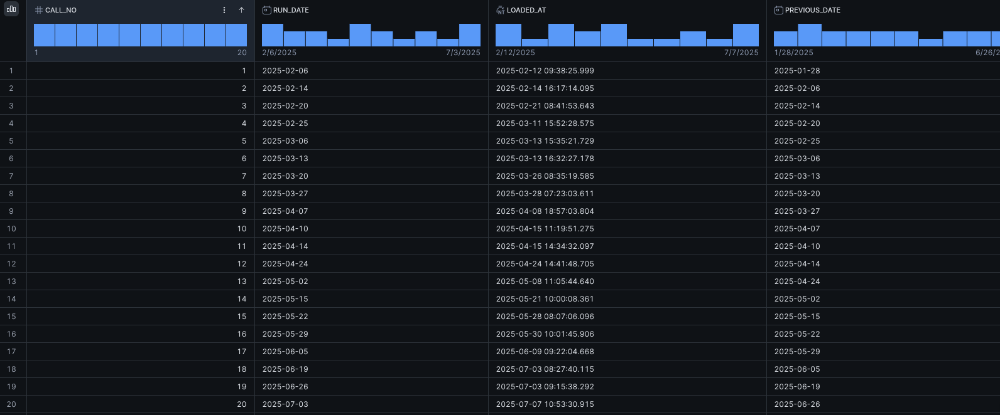

# test_2 in a loop

Yes, the 20 `CALL test_2(...)` statements can be one loop inside a procedure:

- `test_2_loop_postgres.sql`: PL/pgSQL, `FOR ... IN <query> LOOP` with `CALL test_2(...)` inside
- `test_2_loop_snowflake.sql`: Snowflake Scripting, a cursor and `FOR ... IN <cursor> DO`

Both files have three parts: a stand-in `test_2` that only records what it
gets, the loop procedure `run_test_2()`, and a call with a look at what
`test_2` received. The stand-in lives in its own schema, `test_2_demo`, so a
real `test_2` isn't replaced. Where the real one exists, skip the first part
and create `run_test_2()` in the same schema.

## Notes

- Every call's third argument is the first argument of the call before it.
  So the list in the loop only has run dates and load timestamps, and `LAG`
  gives the previous date, with 2025-01-28 before the first run.
- The runs go in date order, like the original calls.
- Separate calls each commit on their own: if one fails, the ones before it
  stay done. In Postgres the loop does the same with a `COMMIT` after every
  call, which is why `run_test_2()` can't be called inside `BEGIN ... COMMIT`.
  In Snowflake, statements inside a procedure commit one by one anyway, with
  AUTOCOMMIT on (the default).
- The real `test_2`'s parameter types aren't in the task. The stand-in takes
  a date, a timestamp and a date, which is what the values look like. If the
  real one takes strings, pass strings: in Snowflake a timestamp turned into
  text has 3 decimals by default, not 9.

## Running

Postgres in Docker:

```
docker run -d --rm --name test2-pg -e POSTGRES_PASSWORD=postgres postgres:18
until docker exec test2-pg pg_isready -q -h 127.0.0.1; do sleep 1; done
docker exec -i test2-pg psql -U postgres -v ON_ERROR_STOP=1 < test_2_loop_postgres.sql
docker stop test2-pg
```

Snowflake: run the whole file with a warehouse and a database selected, or
with `USE WAREHOUSE ...;` and `USE DATABASE ...;` added at the top.

## Results

Both make the same 20 calls, in date order.

Postgres:

```
 call_no |  run_date  |         loaded_at          | previous_date
---------+------------+----------------------------+---------------
       1 | 2025-02-06 | 2025-02-12 09:38:25.999982 | 2025-01-28
       2 | 2025-02-14 | 2025-02-14 16:17:14.095384 | 2025-02-06
       3 | 2025-02-20 | 2025-02-21 08:41:53.643244 | 2025-02-14
       4 | 2025-02-25 | 2025-03-11 15:52:28.57559  | 2025-02-20
       5 | 2025-03-06 | 2025-03-13 15:35:21.729785 | 2025-02-25
       6 | 2025-03-13 | 2025-03-13 16:32:27.178218 | 2025-03-06
       7 | 2025-03-20 | 2025-03-26 08:35:19.585812 | 2025-03-13
       8 | 2025-03-27 | 2025-03-28 07:23:03.611707 | 2025-03-20
       9 | 2025-04-07 | 2025-04-08 18:57:03.80427  | 2025-03-27
      10 | 2025-04-10 | 2025-04-15 11:19:51.275211 | 2025-04-07
      11 | 2025-04-14 | 2025-04-15 14:34:32.097939 | 2025-04-10
      12 | 2025-04-24 | 2025-04-24 14:41:48.705573 | 2025-04-14
      13 | 2025-05-02 | 2025-05-08 11:05:44.64051  | 2025-04-24
      14 | 2025-05-15 | 2025-05-21 10:00:08.361011 | 2025-05-02
      15 | 2025-05-22 | 2025-05-28 08:07:06.096731 | 2025-05-15
      16 | 2025-05-29 | 2025-05-30 10:01:45.906511 | 2025-05-22
      17 | 2025-06-05 | 2025-06-09 09:22:04.66839  | 2025-05-29
      18 | 2025-06-19 | 2025-07-03 08:27:40.115104 | 2025-06-05
      19 | 2025-06-26 | 2025-07-03 09:15:38.29295  | 2025-06-19
      20 | 2025-07-03 | 2025-07-07 10:53:30.915895 | 2025-06-26
(20 rows)
```

Snowflake (Snowsight shows timestamps with 3 decimals; the stored values have
all 9):


